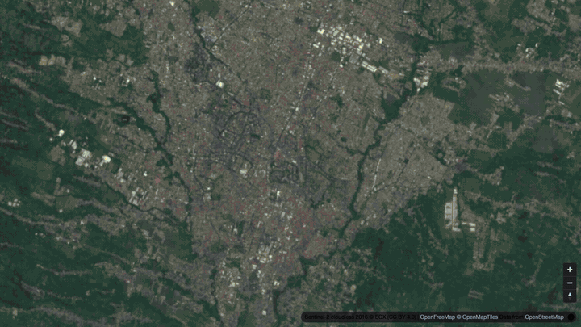

# Socio-economic status from satellite imagery

**Live demo: https://dhaneswaramandrasa.github.io/ses-satellite/**

[](https://dhaneswaramandrasa.github.io/ses-satellite/)

An interactive, open-data version of a project I did at Bhumi Varta (2020–2021): estimate socio-economic status (SES) for every grid cell from satellite imagery, first at 1 × 1 km and then at 100 × 100 m. Case study: [Socio-economic status from satellite imagery](https://dhaneswara-mandrasa.vercel.app/project-ses-satellite).

The original labels came from survey and census data that I can't publish, so this demo uses **real satellite imagery of Malang with synthetic SES labels**. The method is the same; the numbers are not real survey results.

## What it shows

Five steps, matching the case study:

| Step | What happens |
| --- | --- |
| 1 Image | A cloud-free Sentinel-2 mosaic of Malang, East Java (~10 m per pixel), cut into one patch per 100 m cell (22,400 cells) |
| 2 Survey | Labels exist only as 1 km averages, and only for a sample: 129 of 224 cells, as a household survey would give |
| 3 Learn | Each patch goes through a small fixed bank of 3 × 3 convolution filters (edges, texture) with ReLU, plus colour, greenness and bright-roof channels, pooled over the patch and its ~300 m neighbourhood. A ridge model maps the pooled features to the survey value. 5-fold CV R² on held-out 1 km cells: 0.83 |
| 4 Estimate 1 km | The model scores every 1 km cell from its image, including cells the survey never reached |
| 5 Refine 100 m | The same model applied to each 100 m patch. Against the hidden fine-scale SES, the 100 m map explains 57% of the variance; the flat 1 km map explains 44% |

The production work trained CNNs (ResNet-50 transfer learning in PyTorch) on much finer imagery. This demo uses a fixed filter bank and a linear model so it runs in seconds with numpy and the weights stay readable.

## Data

| Layer | Source | Real or synthetic |
| --- | --- | --- |
| Satellite imagery | [Sentinel-2 cloudless 2016](https://s2maps.eu) by EOX, z15 tiles, `scripts/fetch_tiles.py` | Real (contains modified Copernicus Sentinel data 2016, CC BY 4.0) |
| Buildings, roads, parks | OpenStreetMap via Overpass, aggregated to 100 m counts in `data/raw/osm_grid_100m.npz` | Real (© OpenStreetMap contributors, ODbL) |
| SES "truth" per 100 m cell | Generated in `scripts/build_data.py` from the OSM layout, a few things visible from above (tree cover in built-up areas, roof material) and noise | Synthetic |
| Survey labels | 1 km averages of the hidden truth plus survey error, for 60% of cells | Synthetic |

The model sees only pixels and the coarse survey labels. It never sees the OSM data or the 100 m truth.

The Overpass query (bbox −8.05, 112.57, −7.90, 112.70); the 53 MB response is not committed, only the 100 m counts built from it:

```
[out:json][timeout:270][bbox:-8.05,112.57,-7.90,112.70];
(way["building"]; way["highway"~"^(primary|secondary|tertiary|residential|trunk|unclassified)$"]; way["leisure"="park"];);
out center qt;
```

## Run it

```bash
pip install -r requirements.txt     # numpy, pillow
python scripts/fetch_tiles.py       # optional: re-download the imagery into data/raw/
python scripts/build_data.py        # writes web/data/ses.json and web/data/s2_malang.jpg
python -m http.server -d web 8000   # open http://localhost:8000
```

`web/index.html` is a single static page (MapLibre GL + deck.gl from a CDN, basemap from OpenFreeMap). `?step=0`–`4` opens a given step and `?embed` hides the panels. GitHub Actions deploys `web/` to Pages on every push to `main`.

## Layout

```
data/raw/                 Sentinel-2 mosaic, OSM counts per 100 m cell
scripts/fetch_tiles.py    download and stitch the imagery
scripts/build_data.py     grid, synthetic SES, image features, survey sample, ridge model, JSON export
web/index.html            the demo
web/data/                 model output and the downsized image read by the demo
```
